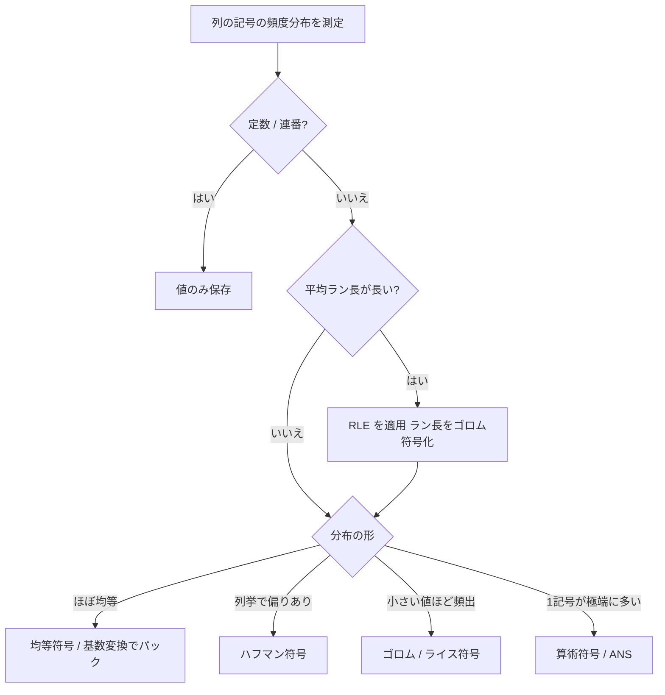

# CSV圧縮 アイデア出し

CSVファイルの圧縮を題材にしたプログラムのアイデア。
汎用圧縮(gzip 等)にそのまま掛けるのではなく、CSV の構造(列ごとの性質、列間の関係)を先に調べ、列ごとに最適な符号化を選んでから圧縮する。

## 各種符号化の方法について

以降の章で使う符号化方法の基礎をまとめる。どの方法を、どの列に使うかは 3 章で扱う。

### 用語

| 用語 | 意味 |
|---|---|
| 記号 | 符号化の対象の 1 単位。列の値(整数、バイト列の文字列)、差分、ラン長など |
| 符号語 | 記号に割り当てるビット列 |
| 接頭符号 | どの符号語も、他の符号語の先頭部分にならない符号。区切りなしで続けて並べても、先頭から一意に復号できる。以降の可変長符号は、すべて接頭符号 |
| 符号表 | 記号と符号語の対応。復号側に渡す必要があるので、圧縮データに含めるか、規則から再生成できるようにする |
| エントロピー | 記号の確率分布から決まる、1 記号あたりの平均情報量の下限 H = −Σ p × log2(p) (ビット)。どの符号化も、平均でこれを下回れない |

符号化の良し悪しは、「平均符号長がエントロピーにどれだけ近いか」と「符号表などの補助情報の大きさ」で決まる。

### 均等符号(固定長符号、打ち切り二進符号)

全記号に同じ長さ(または、ほぼ同じ長さ)の符号語を割り当てる。確率が等しい記号向け。

- 固定長: 記号数 n の場合、各記号に ceil(log2 n) ビットを割り当てる。記号の番号をそのまま 2 進数にする。
- 打ち切り二進符号: n が 2 のべき乗でないとき、短い符号語と長い符号語を使い分けて、無駄を減らす。k = floor(log2 n)、u = 2^(k+1) − n とすると、番号 x が u 未満なら x を k ビット、それ以外は x + u を k + 1 ビットで表す。

| n = 5 の例 | 番号 | 符号語 |
|---|---|---|
| | 0 | `00` |
| | 1 | `01` |
| | 2 | `10` |
| | 3 | `110` |
| | 4 | `111` |

- 固定長では 3 ビット × 5 記号だが、打ち切り二進符号では平均 2.4 ビットになる(確率が等しい場合)。
- 「ワイル符号化」は、この文書では、この均等符号の仲間として扱っている(3.4 の注記を参照)。

### 基数変換によるパック

記号を n 進数の桁とみなし、複数の記号を 1 つの整数にまとめてから 2 進数で保存する。
1 記号あたりのビット数が log2(n) に近づくので、n が 2 のべき乗でないときの無駄を減らせる。

- k 個の記号 x1, x2, ..., xk (各 0 以上 n 未満)を、値 = x1 × n^(k−1) + x2 × n^(k−2) + ... + xk とし、ceil(k × log2 n) ビットで保存する。
- 復号は、値を n で割った余りを後ろから取り出す。
- 異なる記号数の列を組にする場合は、混合基数にする。
- k の決め方と計算例は 3.4 を参照。

### ユナリ符号

非負整数 x を、x 個の `1` と、終端の `0` で表す。

| x | 符号語 |
|---|---|
| 0 | `0` |
| 1 | `10` |
| 2 | `110` |
| 3 | `1110` |

- 符号長は x + 1 で、値が大きいと長くなる。確率が 1/2, 1/4, 1/8, ... と半分ずつ減る分布では、最適になる。
- 単独で使うことは少なく、ゴロム符号やエリアス符号の部品として使う。

### ゴロム符号・ライス符号

小さい値ほど頻度が高い分布(幾何分布に近い。差分、ラン長、件数など)向け。パラメーター m を 1 つ決める。

- 非負整数 x を、商 q = floor(x / m) と、余り r = x mod m に分ける。
- q をユナリ符号で、r を打ち切り二進符号(m 個の記号)で表し、続けて並べる。
- ライス符号は、m を 2 のべき乗(m = 2^k)に限定したもの。r は単に下位 k ビットになるので、割り算が不要で速い。

| x | ゴロム符号 (m = 3) | ライス符号 (m = 4) |
|---|---|---|
| 0 | `0` `0` = `00` | `0` `00` = `000` |
| 1 | `0` `10` = `010` | `0` `01` = `001` |
| 2 | `0` `11` = `011` | `0` `10` = `010` |
| 3 | `10` `0` = `100` | `0` `11` = `011` |
| 4 | `10` `10` = `1010` | `10` `00` = `1000` |
| 9 | `1110` `0` = `11100` | `110` `01` = `11001` |

- 値が平均 μ の幾何分布の場合、m は μ の約 0.69 倍付近(ln 2 × μ)が目安。実際には、候補の m の前後を試して、符号長の合計が最小のものを選ぶ。
- 符号表は不要で、m だけを保存すればよい。
- 負の値を含む場合は、先にジグザグ変換で非負整数にする(後述)。

### エリアス符号(ガンマ符号・デルタ符号)

値の大きさの見当が付かない正の整数向け。パラメーターが不要で、符号表も不要。

- ガンマ符号: x の 2 進表記の桁数を N + 1 として、N 個の `0` に続けて、x の 2 進表記を書く。

| x | ガンマ符号 |
|---|---|
| 1 | `1` |
| 2 | `010` |
| 3 | `011` |
| 4 | `00100` |
| 5 | `00101` |
| 9 | `0001001` |

- デルタ符号: 桁数 N + 1 をガンマ符号で表し、続けて x の 2 進表記から先頭の 1 を除いた N ビットを書く。値が大きいときは、ガンマ符号より短くなる。
- 0 を表したいときは、x + 1 を符号化する。

### ハフマン符号

記号ごとに確率(出現頻度)が大きく異なる列挙向け。出現頻度が高い記号に短い符号語、低い記号に長い符号語を割り当てる。

作り方:

1. 記号を、出現頻度とともに並べる。
2. 頻度が最小の 2 つを選び、1 つの節にまとめる(頻度は合計)。これを繰り返し、木を作る。
3. 根から各記号まで、左を `0`、右を `1` として辿ったビット列が符号語になる。

| 記号 | 確率 | 符号語 |
|---|---|---|
| A | 50% | `0` |
| B | 25% | `10` |
| C | 12.5% | `110` |
| D | 12.5% | `111` |

- この例の平均符号長は 1.75 ビットで、エントロピーと同じ。固定長(2 ビット)より短い。
- 確率が 2 のべき乗(1/2, 1/4, ...)でないと、エントロピーに完全には届かない。1 記号あたり最低 1 ビット必要なので、1 つの記号の確率が極端に高い(0.9 など)場合は効率が悪い(2 値の場合、エントロピー約 0.47 ビットに対して 1 ビット)。この場合は、RLE や算術符号を使う。
- 正準ハフマン符号: 符号長が同じ記号は記号順に符号語を割り当てると決めると、各記号の符号長の表だけから、符号表を再生成できる。保存する補助情報が小さくなる。
- 記号の数が多いとき(辞書の項目が数万など)は、符号表の大きさが無視できなくなるので、見積もりに含めて判断する。

### 算術符号・ANS

メッセージ全体を 1 つの実数(区間)として表す方式。1 記号に必ずしも整数ビットを割り当てないので、エントロピーにほぼ届く。

- 算術符号: 区間 [0, 1) を、記号の確率に応じて分割し、記号ごとに区間を絞り込む。最終的な区間内の 1 つの値を、ビット列として保存する。確率 0.9 の記号は、約 0.15 ビットで符号化できる。
- ANS(非対称数値系): 算術符号と同程度に圧縮でき、処理が速い(rANS、tANS)。状態を表す整数を更新しながら符号化する。復号は符号化と逆順に記号を取り出す。
- ハフマン符号と同様に、確率の表(頻度表)を保存する必要がある。適応型(記号を処理しながら確率を更新)にすると、表を保存しなくてよい。
- 実装は複雑になるので、実装の段階の後半(6 段階)で扱う。

### ランレングス符号(RLE)

同じ値が連続する部分を、(値, 繰り返し回数)の組に置き換える。

| 元の列 | RLE |
|---|---|
| A A A A B B C | (A, 4) (B, 2) (C, 1) |

- 連続が多い列では、大きく縮む。連続が少ない列では、かえって大きくなる(適用可否の判定は 3.3 を参照)。
- 値の部分とラン長の部分を、別々の列として符号化できる。ラン長にはゴロム符号が合う。
- 値の列にも、差分を取った後の列にも、適用できる。

### 差分符号化・ジグザグ変換・可変長整数

大きな値を、小さな値の列に変換して、他の符号化を効きやすくする前処理。

- 差分符号化: 前の値との差を保存する。1000, 1003, 1005, 1006 は、先頭の 1000 と、差の +3, +2, +1 になる。単調に増える列(日時、連番に近い列)で有効。
- ジグザグ変換: 負の値を含む整数を、非負整数に対応付ける。0, −1, 1, −2, 2, ... を 0, 1, 2, 3, 4, ... に対応付ける。計算式は (n << 1) XOR (n >> 63)。ゴロム符号やエリアス符号は非負整数が前提なので、差分に続けて使う。
- 可変長整数(バイト単位): 7 ビットずつ下位から取り出し、最上位ビットを「続きがあるか」のフラグにする(LEB128 / VByte)。

| 値 | 可変長整数(16 進) |
|---|---|
| 100 | `64` |
| 300 | `AC 02` |

  300 は、下位 7 ビット(`0101100`)に続きフラグを付けた `AC`、残りの値 2 を `02` として並べる。バイト境界に揃うので扱いやすく、速い。ただし、値が小さい場合でも最低 1 バイトかかるので、ビット単位の符号(ゴロム符号など)より大きくなりやすい。

### 辞書符号

よく出る値の表(辞書)を作り、値を辞書の番号に置き換える。

- 列挙の列で、値(バイト列)を番号に置き換える。番号は、均等符号やハフマン符号などで符号化する。
- 番号を出現頻度の降順に付けると、小さい番号ほど頻度が高くなるので、ゴロム符号やエリアス符号と相性がよい。
- 辞書そのものを保存する必要がある。辞書の大きさも含めて、効果を見積もる(ユニーク値が多すぎると逆効果)。
- 汎用圧縮(LZ 系の辞書式圧縮)は、辞書を自動的に作りながら圧縮するもので、表を保存する必要がない。自由文字列の列は、これに任せる。

#### 標準辞書(圧縮ソフトウェア側で持つ辞書)

都道府県コードや性別コードのように、値の集合が標準で決まっている列は、辞書を圧縮データに含めず、圧縮ソフトウェア側に組み込んでおいてよい。辞書の保存が不要になり、特に小さなファイルや、ユニーク値が多い列で効果が大きい。

組み込み辞書の候補:

| 辞書 | 内容 |
|---|---|
| 都道府県コード | `01`〜`47`(JIS X 0401)と、都道府県名(正式名、「県」等を省いた名、ローマ字名など) |
| 性別コード | `0` 不明 / `1` 男性 / `2` 女性 / `9` 適用不能(ISO 5218)と、`M` / `F`、`男` / `女` などの表記 |
| 国・地域コード | ISO 3166-1(アルファベット 2 文字・3 文字、数字)と国名 |
| 通貨コード | ISO 4217(`JPY`、`USD` など) |
| 言語コード | ISO 639 |
| 曜日・月名 | `Mon`〜`Sun`、`月`〜`日`、`Jan`〜`Dec`、`1月`〜`12月` など |
| 真偽値・フラグ | `Y` / `N`、`true` / `false`、`有` / `無`、`0` / `1` など |

使い方:

1. 列の値(`body` のバイト列)がすべて、ある標準辞書の表記のいずれかに一致するかを確認する(辞書や表記の種類を、列ごとに選ぶ)。
2. 一致したら、値を辞書の番号に置き換えて符号化する。辞書の IDと版を、圧縮プラン(3.6)に記録する。
3. 一部だけ辞書にない値がある場合は、「辞書にない」という特別な番号 + 元の値(バイト列)を例外として保存する。例外が多い場合は、標準辞書を使わず、データから作る辞書にする。

注意点:

- **表記の揺れ**: `01` と `1`、`東京都` と `東京` は、バイト列として別の値。表記の種類ごとに別の辞書(または辞書内の別の列)として持ち、列ごとにどれを使うかを選ぶ。一つの列内で表記が混在している場合は、元の表記を復元できるように、「どの表記の辞書を使ったか」を値ごとに符号化するか、例外とする。
- **文字コード**: 文字列はバイト列のまま扱うが、辞書の判定には `CsvItem.getText()`(`body` を列の文字コードでデコードした文字列。デコードできないときは `null`)を使う。組み込み辞書は文字列として持ち、`getText()` の結果と比較する。比較で辞書の値が決まったら、辞書の表記を列の文字コードでエンコードし、`body` とバイト単位で一致することを確認する(一致しない項目は例外として `raw` を保存する)。圧縮データには番号だけが入る。復元時は、同じ辞書を同じ文字コードでエンコードして、バイト列を得る。
- **版の管理**: コードは改定されることがある(市区町村コードは特に頻繁に変わる)。変更しても古い圧縮ファイルを展開できるように、辞書に ID と版を付け、古い版も残す。圧縮ファイルには、使用した辞書の ID、版、(変更検出用に)辞書内容のハッシュ値を記録する。
- **番号の付け方**: 標準のコード順(都道府県なら 1〜47)をそのまま番号にする。値ごとの頻度は、実データで測定して、符号化は 3.4 のとおりに選ぶ(均等であれば均等符号、偏りがあればハフマン符号)。都道府県は 47 種類なので、均等符号なら 6 ビット。
- **コードと名称の対応**: 「都道府県コード」列と「都道府県名」列は、同じ辞書の同じ番号になる。列の相関(2.4 の 1 対 1)と組み合わせると、片方の列を保存せず、辞書から復元できる。
- 試作では、都道府県・性別・真偽値の数種類を、プログラムのリソースとして持つことから始める。

### 方式の比較

| 方式 | 向いている分布 | 補助情報 | 速度 | 備考 |
|---|---|---|---|---|
| 均等符号 | 確率が等しい | 記号表のみ | 速い | 記号数が 2 のべき乗でないと無駄が出る |
| 基数変換のパック | 確率が等しい | 記号表のみ | 速い | 無駄がほぼ無い。まとめる個数 k を決める |
| ユナリ符号 | 半分ずつ減る分布 | 不要 | 速い | 部品として使う |
| ゴロム / ライス符号 | 小さい値ほど頻出(幾何分布) | m のみ | 速い | 差分やラン長に合う |
| エリアス符号 | 値の大きさが不明 | 不要 | 速い | パラメーターが不要 |
| ハフマン符号 | 確率が記号ごとに異なる | 符号長の表 | 普通 | 1 記号あたり最低 1 ビット |
| 算術符号 / ANS | 任意(偏りが極端でもよい) | 頻度表 | やや遅い | エントロピーにほぼ届く |
| RLE | 同じ値が連続 | ほぼ不要 | 速い | 他の符号化と組み合わせる |
| 可変長整数 | 小さい整数が多い | 不要 | 速い | バイト単位で、扱いやすい |

選び方の判断手順は 3.4 を参照。

## 圧縮処理の流れ


- 1: ファイル全体の書式(引用符、改行、区切り文字など)を確認する。
- 2: 列ごとの統計(カーディナリティ、型、頻度、列間の相関)を測定する。
- 3: 2 の結果から列ごとに符号化方式を選ぶ。
- 4: 符号化した列データを、最後に汎用圧縮でまとめて圧縮する。

---

## 1. フォーマットの確認

目的: 元ファイルを完全に復元するための「書式情報」を取り出し、データ本体から切り離す。

| 項目 | 確認内容 | 圧縮への利用 |
|---|---|---|
| 文字コード | UTF-8(BOM 有無) / MS932 / UTF-16 など | 文字列は変換せず、バイト列のまま扱う(復元時の再エンコードが不要)。文字コード(と BOM の有無)は、区切り文字・引用符・改行の判定と表示のためにメタ情報に保存する |
| 改行コード | CRLF / LF / CR、混在の有無 | 全行同じなら 1 個の値だけ保存。混在なら例外行のみ位置を記録 |
| 末尾改行 | 最終行に改行があるか | 1 ビットで保存 |
| 区切り文字 | `,` / タブ / `;` など | メタ情報に保存 |
| 引用符(`"`) | 全フィールドが引用符付き / 必要なフィールドのみ / 引用符なし | 全部付き・全部なしなら書式として 1 回だけ記録して本文から除去 |
| 引用符の例外 | 特定の列だけ引用符付き、値が数値のときだけ無し、など | 列ごとの引用符ルールとして保存 |
| エスケープ | `""` による重ね書き / バックスラッシュ | 値に含まれる文字を調べ、必要なときだけ処理 |
| 1 行目(ヘッダー) | 有無の判定、列名の重複、2 行目以降との書式・列数・型の違い | 1 行目は別枠で保存し、引用符のルールも 2 行目以降と別に持つ(下の「1 行目と 2 行目以降」を参照) |
| 列数の揃い | 全行同じ列数か、不足・超過の行があるか | 揃っていれば列数は 1 個のみ保存 |
| 空行・コメント行 | 空行、`#` 始まりなど | 位置を記録して除去 |
| 前後の空白 | フィールド前後の空白の有無 | 列ごとのルールとして保存 |

### 可逆性の方針

- **完全な可逆性(バイト一致)を必須とする。**
- 書式がルールで説明できる部分は「ルール + 例外リスト」で保持する。
- 例外が多くなりすぎる場合は、ルール化を諦めて生のバイト列として保持する(フォールバック)。
- 必ず「復元して元ファイルとバイト単位で一致するか」を検証する(ラウンドトリップ検証)。不一致ならフォールバックするか、圧縮を中止する。

### CSV ITEM(パーサーの出力単位)

バイト一致を保証するため、数値などの型付きの値を除き、フィールドの内容は文字列(String)に変換せず、バイト列のまま扱う。パーサーは少し遅くてよい。
文字コード変換を挟まないので、不正なバイト列や、MS932 で複数のバイト列が同じ文字に割り当てられている文字(NEC 特殊文字と IBM 拡張文字の重複など)でも、復元で値が変わることはない。
現行の `Csv` / `Builder` は String だけを保持しているので、圧縮用にこの情報を持つパーサーを用意する(既存のパーサーを拡張しても、別に作ってもよい)。

| フィールド | 内容 |
|---|---|
| `byte[] raw` | ファイル上の元のバイト列(引用符・エスケープを含む、区切り文字は含めない) |
| `byte[] body` | 引用符を外し、エスケープを戻した後の内容のバイト列。文字列として扱う列は、これを符号化の対象にする |
| `boolean quoted` | ダブルクォートでクォートされていたか |
| その他のフラグ | 前後に空白があったか、引用符内のエスケープ(`""`)の有無 など |

数値・日付などの型付きの値は、`body` を文字列として解釈して得る(型推定の結果、その列が数値などと判定されたときだけ)。
文字列を必要とする判定(型の推定、都道府県名などの標準辞書との照合)のために、`CsvItem` に `getText()` を用意する。`body` を `CsvDocument` の文字コードでデコードして返し、デコードできないときは `null` を返す。結果は保持せず、呼ぶたびに計算する。保存・復元・検証には使わず、バイト列を基準にする。
レコード(行)側も、行末のバイト列(CRLF / LF / CR / なし)を保持する。

圧縮時の使い方:

1. 圧縮の本体は `body`(型付きの列は解釈した値)と `quoted` を対象に符号化する。
2. 書式ルール(「列 3 は常に引用符付き」など)からバイト列を再生成し、`raw` と一致するかを確認する。
3. 一致しない ITEM だけを、`raw` を例外として(位置とともに)保存する。
4. 型付きの列で、値から元の表記を再現できない場合(`+5`、`1.50` と `1.5` のような表記の揺れなど)も、`raw` を例外として保存する。

UTF-16 のように ASCII 互換でない文字コードでは、区切り文字・引用符・改行の判定をコードユニット(2 バイト)単位で行う。`raw` / `body` は、その場合もファイル上のバイト列のままにする。

### 1 行目と 2 行目以降は別物として扱う

1 行目はヘッダーであることが多く、2 行目以降(データ)と性質が異なる。混ぜて扱うと、ルールの当てはまりが悪くなり、統計や符号化の効果も落ちる。そのため、以降のすべての工程で分けて考える。

- 引用符: ヘッダーだけ全部引用符付き、データは必要なときだけ、のようなファイルがある。引用符のルールを、1 行目と 2 行目以降で別に持つ。
- 列数: 主な列数は 2 行目以降から決める。
- 型・統計・辞書・符号化: 型の推定、ユニーク値数、頑度、ラン長、標準辞書との照合、符号化の対象は、2 行目以降だけにする(列名は値の分布に属さない)。
- 保存: ヘッダーと判定した 1 行目は、別枠でバイト列のまま保存する。
- ヘッダーの有無の判定: 1 行目と 2 行目以降で、引用符のルール・型・列数・値の重複が異なるかを手掛かりにする。判定が外れても可逆性には影響せず、圧縮率だけに影響する。ヘッダー無しと判定した場合は、1 行目をデータとして扱う。

---

## 2. 列プロファイリング

### 2.1 基本統計(列ごと)

- 行数、空欄数(null 率)
- ユニーク値数、カーディナリティ比(ユニーク値数 ÷ 行数)
- 長さ(バイト数)の最小・最大・平均
- 値の頻度分布(上位 N 件、エントロピー)

これは Csv5963 に追加した Info メニュー(Column Summary)の内容と共通するため、そのロジックを流用できる。

### 2.2 型の推定

各列を以下のうち最も狭い型に分類する(判定は `body` を ASCII のバイト列として見て行う。ASCII 以外のバイトを含む列は、自由文字列かバイト列の列挙になる)。

| 型 | 判定 | 備考 |
|---|---|---|
| 真偽値 | 値が 2 種類(`0/1`, `Y/N`, `true/false`) | 1 ビット |
| 整数 | `^-?\d+$`(先頭ゼロなし) | 範囲から必要ビット幅を決める |
| ゼロ埋め数字 | `^0\d+$`、桁数固定 | 「文字列」でなく「桁数 + 整数」として保持 |
| 小数 | 小数点以下の桁数が一定 | 整数 + 小数桁数 |
| 日付・日時 | `yyyy-MM-dd`, `yyyy/MM/dd` など | エポックからの日数 / 秒数 |
| 連番 | 1 行ごとに +1 | 開始値と刻みだけ保存 |
| 列挙 | カーディナリティが小さい値(バイト列として比較) | 辞書(バイト列)+ 符号 |
| 自由文字列 | 上記以外(バイト列のまま扱う) | 汎用圧縮や辞書圧縮 |
| 定数列 | ユニーク値が 1 | 値を 1 個だけ保存 |

### 2.3 カーディナリティの測定

- 全件を数えるとメモリが重いので、大きなファイルでは近似する(HyperLogLog、サンプリング)。
- ユニーク値が増え続けるかを見る(先頭 N 行ではユニークが少ないが後半で増える、のようなケースの検出)。
- 列挙列として扱う閾値の例: ユニーク値数 ≤ 256(1 バイトで符号化可能)、または ≤ 65536。

### 2.4 列の相関

列 N の値が決まったときに列 M がどうなるかを調べる(カーディナリティが小さい列同士で有効)。

| 関係 | 意味 | 圧縮への利用 |
|---|---|---|
| 1 対 1 | N と M が相互に決まる(例: 都道府県コードと都道府県名) | 片方を保存し、もう片方は対応表から復元 |
| N → M(関数従属) | N が決まれば M が一意に決まる(例: 市区町村 → 都道府県) | M の列を削除し、対応表を保存 |
| 偏りのある対応 | N ごとに M の分布が大きく偏る | M の符号を N 別の頻度表で符号化(条件付きエントロピー) |
| 導出可能 | 列 C = 列 A + 列 B、単価 × 数量 = 金額など | 計算式と、一致しない行の例外のみ保存 |
| 順序・差分 | 列 A ≦ 列 B(開始日と終了日) | 差分を保存 |
| 同値 | 2 列が常に同じ | 1 列に統合 |

評価指標の案:
- 関数従属度 = 1 − (矛盾する行数 ÷ 行数)。1.0 なら厳密、0.99 以上なら「例外付きで従属」として扱う。
- 条件付きエントロピー H(M|N) と H(M) の差を、削減できるビット数の見積もりとして使う。
- 列の組が多い場合は全組み合わせ (O(列数²)) を避け、ユニーク値数が小さい列だけに絞る。

---

## 3. 圧縮スキームの決定

### 3.1 列ごとの符号化方式

| 列の性質 | 候補となる符号化 |
|---|---|
| 定数 | 値 1 個のみ |
| 連番 | 開始値 + 刻み |
| 真偽値 | ビットパック |
| 列挙(低カーディナリティ) | 辞書 + 固定長符号、または頻度に基づくハフマン符号 |
| 列挙で、標準のコード体系に当てはまる(都道府県・性別など) | 組み込みの標準辞書(辞書の保存が不要) |
| 列挙で確率が等しい | 均等符号、基数変換によるパック (3.4) |
| 列挙で偏りが大きい | ハフマン符号 / 算術符号 / ANS |
| 整数 | 最小値を引いて可変長整数、前行との差分(単調な列に有効)。分布によりゴロム / ライス符号 |
| 小数 | 整数化して整数と同様に扱う |
| 日付・日時 | エポックからの値に変換し、差分 |
| 連続して同じ値が続く列 | ランレングス符号(RLE)。適用可否は 3.3 で判定 |
| 同じ値が散発する中カーディナリティの列 | 辞書 + 可変長符号 |
| 自由文字列 | 列単位で汎用圧縮(列ごとにまとめると行単位より効率が良い)、前行との共通接頭辞 |
| 他の列から導出可能 | 保存しない(式 + 例外のみ) |

### 3.2 方式選択の考え方

- 各列について候補方式ごとに、サンプルまたは全件で「圧縮後サイズ」を見積もり、最小のものを採用する(コストベースの選択)。
- 辞書や頻度表のサイズも含めて見積もる(辞書が大きすぎると逆効果)。
- 列の並べ替えの影響: 行順を変えると RLE や差分が効くが、元の順序を復元するための情報が必要になる。行順を保つモードを標準とし、並べ替えはオプションにする。

### 3.3 ランレングス符号の適用可否

同じ値(または同じ差分)が連続する列にだけ RLE を適用する。連続しない列に適用すると、かえって大きくなる。

判定に使う指標(列ごとに 1 パスで測定できる):

- ラン数 R(値が変わる回数 + 1)と、行数 N から求める平均ラン長 L = N / R。
- ランが 1 行だけのものの割合(長さ 1 のランが多いと不利)。
- ラン長の分布(多くが短いか、長いものが混在するか)。

見積もりによる判定:

```
通常の符号化 : N × (値あたりのビット数)
RLE          : R × (値あたりのビット数 + ラン長の符号長) + 補助情報
→ RLE のほうが小さければ適用する
```

- 目安として、平均ラン長 L が 2〜3 を超えると有利になりやすい。ただし値の符号長が短い列(真偽値、少数の列挙)ほど、ラン長の符号長の割合が大きくなるので、実際には見積もりで比較する。
- 適用先の候補: 生の列だけでなく、差分を取った後の列(同じ増分が続く)、頻度符号化の前の記号列、列挙値の列。
- 事前にソート済み・グループ化済みの列(日付順の明細の日付列、グループキー列)は、特に効く。
- ラン長そのものは、短いものが多い幾何分布に近くなるため、ゴロム符号(3.4)で符号化すると効率がよい。
- 2 つの列を組にして RLE にかける案もある(「都道府県 + 市区町村」が連続する場合など)。

### 3.4 符号化方式の選択

列の記号(値、または差分・ラン長)の確率分布を調べ、分布の形に合う方式を選ぶ。

| 分布の形 | 向いている方式 | 備考 |
|---|---|---|
| 全記号の生起確率がほぼ等しい | 均等符号(ワイル符号化※、打ち切り二進符号)、混合基数のパック | 記号数が 2 のべき乗でない場合は後述の例を参照 |
| 記号ごとに確率が大きく異なる(列挙) | ハフマン符号化 | 記号ごとの出現頻度から符号を作る。正準ハフマンなら符号長の表だけを保存すればよい |
| 小さい値ほど頻度が高い(差分、ラン長、件数など) | ゴロム符号化、ライス符号化 | 幾何分布に近い場合に、ほぼ最適 |
| 値の大きさの見当が付かない整数 | エリアスのガンマ符号・デルタ符号 | パラメーター不要 |
| 1 つの記号の確率が極端に高い(例: 0.9 以上) | RLE と併用、または算術符号・ANS | ハフマンは 1 記号あたり最低 1 ビット必要で、効率が悪い |

※ 「ワイル符号化」は、ここでは確率が等しい場合に使う均等な(固定長系の)符号という前提で扱っている。意図している方式が違う場合は、後で差し替える。

#### 確率が等しい場合: 基数変換によるパック

記号が 3 種類で確率が等しい場合、情報量は 1 記号あたり log2(3) ≒ 1.585 ビット。
1 記号ごとに 2 ビットで保存すると、約 26% 無駄になる。
複数の記号をまとめて 3 進数として 1 つの整数にし、それを 2 進数で保存すると、この無駄を減らせる。

| まとめる個数 k | 3^k | 必要なビット数 | 1 記号あたり |
|---|---|---|---|
| 1 | 3 | 2 | 2.000 |
| 3 | 27 | 5 | 1.667 |
| 5 | 243 | 8 (1 バイトに収まる) | 1.600 |
| 8 | 6561 | 13 | 1.625 |
| 10 | 59049 | 16 (2 バイトに収まる) | 1.600 |

- 5 個を 1 バイトにする方式はバイト境界に揃うので扱いやすいが、試作では「無駄の最小」を優先して k を決める(下記)。
- 一般化すると、記号数 n の列は、k 個ずつまとめて n 進数の整数にし、ceil(k × log2 n) ビットで保存する。k は、ビット数の無駄が最小になる値を選ぶ。
- **k の決め方(無駄最小優先)**: k = 1, 2, 3, ... について ceil(k × log2 n) / k (1 記号あたりのビット数)を計算し、最小になる k を選ぶ(同じなら小さい k)。まとめた整数が整数型(例: 64 ビット)に収まる範囲を k の上限とする。例: n = 3 で上限 64 ビットの場合、k = 29 (46 ビット、1 記号あたり 1.586)が最小になる(理論値は 1.585)。バイト境界には揃えない。
- 列の記号数が k の倍数でない場合、最後のブロックだけ r 個分 (ceil(r × log2 n) ビット)で保存する。
- 複数の列にまたがる場合は混合基数にする。列の記号数が c1, c2, c3 のとき、値 = (x1 × c2 + x2) × c3 + x3 とすると、3 列分を ceil(log2(c1 × c2 × c3)) ビットで保存できる(例: 3 択、5 択、7 択の 3 列は 105 通りなので 7 ビット。列ごとに保存すると 2 + 3 + 3 = 8 ビット)。
- 記号数が 2 のべき乗でない場合の別案として、打ち切り二進符号がある。n = 5 の場合、3 個の記号には 2 ビット、残り 2 個の記号には 3 ビットを割り当てる。k 個まとめる方式より単純で、ビット境界を気にしなくてよい。
- 確率が完全には等しくない場合は、どの程度偏っているかを見て、均等符号とハフマン符号を見積もりで比較する。

#### 方式の選択手順



実際には分布の形を決め打ちせず、候補をすべて試して見積もりサイズを比較する。

```
見積もりサイズ(方式) = 符号化後のビット数の合計 + 補助情報のサイズ
  均等符号     : N × log2(n) をバイト・ビット境界に切り上げたもの + 記号表
  ハフマン符号 : Σ(出現数 × 符号長) + 符号長の表 + 記号表
  ゴロム符号   : Σ(値ごとの符号長) + パラメーター m (m は平均値から決め、前後も試す)
  比較の基準   : エントロピー H = −Σ p × log2(p) × N (この値を下回ることはない)
```

- エントロピーと各方式の見積もりの差を見れば、「これ以上は縮まない」「まだ余地がある」が分かる。
- ゴロム符号のパラメーター m は、平均値の約 0.69 倍付近から探す。2 のべき乗に限定したものがライス符号。
- 負の値を含む場合は、0, −1, 1, −2, 2, ... の順に非負整数へ対応付けてから(ジグザグ変換)符号化する。
- 圧縮プラン(3.6)には、選んだ方式とパラメーター、見積もりサイズ、エントロピーとの差を記録する。

### 3.5 列ごとの格納 (カラムナー形式)

行指向のまま圧縮するより、列ごとにまとめて格納するほうが、同じ性質のデータが並ぶので圧縮効率が上がる(Parquet や ORC と同じ考え方)。ただし、一部の行だけ読みたい用途には不利になるので、行グループ(例: 1 万行単位)に分割する案もある。

### 3.6 圧縮計画 (プラン) の保存

決定した内容は、そのまま「圧縮プラン」として人が読める形(JSON など)で出力できるようにする。
- 列ごとの型、符号化方式、見積もり削減量。
- ユーザーがプランを編集し、手動で方式を上書きできる。
- 学習用の題材として、なぜその方式が選ばれたかの理由を表示する。

---

## 4. 圧縮

### 4.1 出力ファイル構造(案)

```
[ヘッダー: マジックナンバー, バージョン]
[書式メタ情報: 文字コード, 改行, 区切り文字, 引用符ルール, 列数, ヘッダー行]
[圧縮プラン: 列ごとの方式]
[列データ 1][列データ 2] ... [列データ N]
[例外情報: 書式の例外, 導出列の不一致行]
[チェックサム]
```

### 4.2 処理の段階

1. パース(元のバイト列、引用符を外したバイト列、引用符のフラグを保持する CSV ITEM にする。文字列への変換はしない)
2. 列ごとに符号化(辞書化、差分、ビットパックなど)
3. 全体をエントロピー符号化または汎用圧縮(Deflate、LZMA、zstd 相当)
4. 書き出し

### 4.3 展開と検証

- 展開して元ファイルとバイト単位で一致するか確認する機能(`verify` オプション)。
- 破損検出のためのチェックサム。

### 4.4 大きなファイルへの対応

- 基本方針: メモリーに全件を載せて処理する(試作ではこれでよい)。<br>(全件が載らないデータは、「ある程度のレコード数(行グループ)で分割して、グループごとに独立して圧縮する」ことを想定し、実装しない)
- グループごとに統計を取ってプランを決める(グループごとに方式が変わってよい)。書式メタ情報はファイル全体で 1 回だけ保存する。
- ストリーミング処理と 2 パス方式(最初のパスで統計を取り、2 回目のパスで圧縮)は、グループ単位で適用する。

---

## 評価・比較のアイデア

- 比較対象: 非圧縮、gzip、zip、bzip2、xz。
- 指標: 圧縮率、圧縮・展開の時間、メモリ使用量。
- 題材データ: 売上明細(連番、日付、商品コード、数量)、住所録(都道府県と市区町村の関係)、ログ(タイムスタンプ、レベル、メッセージ)、センサーデータ(数値の時系列)。
- 列ごとの内訳(どの列がどれだけ小さくなったか)をレポートする。

★ 「圧縮レポート」を作成すること！

## Csv5963 との連携案

- Info メニューに「Compression Estimate」を追加し、各列の推定圧縮率とプランを表示する。
- Convert メニューに「Save as Compressed」を追加する。
- 圧縮ファイルのドラッグ & ドロップで展開して開く。

## 段階的な実装案

| 段階 | 内容 |
|---|---|
| 1 | フォーマット解析(書式メタ情報の抽出と復元の検証) |
| 2 | 列プロファイリング(型推定、カーディナリティ、頻度) |
| 3 | 列ごとの単純な符号化(定数、辞書、差分、可変長整数、基数変換のパック、ハフマン、ゴロム、RLE)と汎用圧縮の組み合わせ |
| 4 | 圧縮プランの自動決定(コストベース)。RLE の適用可否判定、符号化方式(均等符号、ハフマン、ゴロム)の選択 |
| 5 | 列間の相関の利用(関数従属、導出列) |
| 6 | 算術符号・ANS、行グループ、2 パス処理 |

## 決定事項

- 完全な可逆性(バイト一致)を必須とする。そのためパーサーは、CSV ITEM に元のバイト列と、引用符を外したバイト列、クォートのフラグを保持し、少し遅くてよい(1 章)。
- 数値など以外の値は、文字列に変換せずバイト列のまま扱う(文字コード変換による不一致を避ける)。
- メモリーに全件を載せる。載らないデータは、ある程度のレコード数で分割して圧縮する(4.4)。
- 独自形式とする(試作プログラムのため、Parquet 等には寄せない)。
- 基数変換でまとめる個数 k は、無駄の最小を優先する(3.4)。
- 1 行目と 2 行目以降は別物として扱う(1 章)。特に、引用符のルールを別に持ち、統計・型の推定・符号化は 2 行目以降を対象にする。

## 未決事項・検討事項

- 相関の検出に使う閾値(列挙とみなすユニーク値数、関数従属度)。
- 「ワイル符号化」の具体的な方式(3.4 では均等符号として扱っている)。
- レコード分割のグループサイズ。
