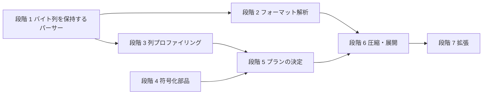

# CSV圧縮 実装計画と予実

[CSV圧縮_アイデア出し.md](CSV圧縮_アイデア出し.md) の内容を、実装できる単位に分けた計画。
最初の作業は、CSV の読み取り処理を、元のバイト列とダブルクォートの有無を保持する形に作り直すこと。

- 状態の欄は「未着手 / 進行中 / 完了」で更新する。
- 予実の「実績・差異」の欄に、実際に行った内容と、計画との違いを書く。

## 実装の前提

- Java 8(`.classpath` の JavaSE-1.8)。`var`、`record`、`List.of` は使わない。
- ビルドは `build.bat`(`src` を `bin` にコンパイルする)。
- テストライブラリーは入っていないので、`main` メソッドで動く自己検証用のテストを作る(JUnit は使わない)。
- 既存の GUI(`Csv5963`、`CsvToModel`)の動作は変えない。新しいパーサーは、既存のものとは別のクラスとして追加する。
- 試作なので、速度やメモリー使用量より、バイト一致を優先する。

## 設計上の原則: 1 行目と 2 行目以降は別物として扱う

1 行目はヘッダーであることが多く、2 行目以降(データ)と性質が異なる。混ぜて扱うと、書式のルールの当てはまりが悪くなり、統計や符号化の効果も落ちる。そのため、すべての段階で「1 行目」と「2 行目以降」を分けて考える。

| 違い | 例 | 対応 | 段階 |
|---|---|---|---|
| 引用符 | ヘッダーだけ全部引用符付き、データは必要なときだけ | 引用符のルールを、1 行目と 2 行目以降で別に持つ | 2(実装済み) |
| 列数 | ヘッダーだけ列数が異なる | 主な列数は 2 行目以降から決める。ヘッダーの列数は例外として記録する | 2(実装済み) |
| 型 | ヘッダーは文字列、データは数値や日付 | 型の推定は 2 行目以降で行う | 3 |
| 値の分布 | 列名は、データの値の頑度分布に属さない | ユニーク値数、頑度、エントロピー、ラン長、辞書、符号化の対象から、ヘッダーを外す | 3〜5 |
| 標準辞書 | 列名「都道府県」は、都道府県名の辞書にない | 辞書との一致の判定は 2 行目以降で行う | 5 |
| 保存 | ヘッダーは列名で、符号化の対象としては特殊 | ヘッダーと判定した 1 行目は、別枠でバイト列のまま保存する | 6 |

ヘッダーの有無の判定(段階 3)の手掛かり:

- 1 行目と 2 行目以降で、引用符のルールが異なる。
- ある列で、2 行目以降が数値や日付で、1 行目だけがそうでない。
- 1 行目の値が、その列の他の値と重複しない、または列挙の値集合に含まれない。
- 1 行目だけ列数が異なる。

判定が外れても、バイト一致の可逆性には影響しない(1 行目の書式は常に別で記録するため)。影響するのは、圧縮率だけ。ヘッダー無しと判定した場合は、1 行目をデータとして統計・符号化に含める。

## 全体の段階

| 段階 | 内容 | アイデア出しの章 |
|---|---|---|
| 1 | バイト列とクォートの有無を保持するパーサー(本計画で詳細化) | 1 章(CSV ITEM) |
| 2 | フォーマット解析(書式メタ情報の抽出と、復元の検証) | 1 章 |
| 3 | 列プロファイリング(型推定、カーディナリティ、頻度) | 2 章 |
| 4 | 符号化の部品(ビット入出力、各種符号) | 「各種符号化の方法について」 |
| 5 | 圧縮プランの決定(見積もり、標準辞書) | 3 章 |
| 6 | 圧縮ファイルの書き出しと、展開・検証 | 4 章 |
| 7 | 拡張(列の相関、算術符号・ANS、行グループ、GUI 連携) | 2.4、4.4、連携案 |

段階 3 と 4 は、段階 1 が終われば、互いに独立して進められる。

---

## 段階 1: バイト列を保持するパーサー

### 現状の問題

既存の `Csv` / `Builder` は、そのままでは圧縮に使えない。

| 項目 | 現状 | 圧縮での問題 |
|---|---|---|
| 読み取り | `BufferedReader.readLine()` で文字列に変換 | 元のバイト列が失われる。文字コード変換が入る |
| 改行 | `readLine()` が改行を取り除き、引用符内の改行は `\n` に置き換える | CRLF / LF / CR の区別と、混在の情報が失われる |
| 引用符 | 引用符の有無を保持しない | 「列ごとの引用符ルール」を調べられない |
| 空白 | `STRICT_ANALYZE` では、区切り文字の直後の空白が空の項目を作る | 値がバイト単位で再現できない |
| エラー | 不正な書式は例外で読み取りを止める | 不正な部分も、そのまま保持して先へ進みたい |
| 書き出し | `write()` は、値に引用符と区切り文字の両方が含まれるときだけ引用符を付ける(条件が `||`) | 区切り文字だけを含む値が、引用符なしで書かれて壊れる。圧縮とは別の既存の不具合として、今回は直さない |

このため、既存のパーサーは変更せず、バイト列を保持する新しいパーサーを追加する。

### 設計

#### パッケージとクラス

既存の `com.github.novisoftware.csv` に、次のクラスを追加する(圧縮処理は、後で別パッケージ `com.github.novisoftware.compress` に置く)。

| クラス | 役割 |
|---|---|
| `CsvEncoding` | 文字コードの情報(名前、1 単位のバイト数、バイト順、BOM のバイト列)。区切り文字・引用符・改行を、そのエンコードのバイト列で表す |
| `CsvItem` | 1 個のフィールド。`byte[] raw`、`byte[] body`、`boolean quoted`、`boolean irregular`、およびメソッド `String getText()` |
| `CsvRecord` | 1 行。`List<CsvItem> items`、`byte[] terminator`(行末のバイト列。最終行で改行がなければ空) |
| `CsvDocument` | ファイル全体。`CsvEncoding`、区切り文字、引用符、`List<CsvRecord> records`、`toBytes()` |
| `CsvRawParser` | `byte[]` から `CsvDocument` を作るパーサー |

#### CsvItem の各フィールド

| フィールド | 内容 |
|---|---|
| `raw` | ファイル上の元のバイト列(引用符・エスケープを含み、区切り文字は含めない) |
| `body` | 引用符を外し、`""` を `"` に戻した内容のバイト列 |
| `quoted` | 先頭が引用符で、書式どおりに閉じられている |
| `irregular` | 標準的な書式に当てはまらない。`irregular` が真のときは `body` = `raw`、`quoted` = 偽 とする |

- 通常の項目(`irregular` が偽)は、次の式で `body` と `quoted` から `raw` を再生成できる。
  - `quoted` が真: 引用符 + `body` の引用符を `""` に置き換えたもの + 引用符
  - `quoted` が偽: `body` と同じ
- 空白は削らない。前後の空白も、そのまま `raw` / `body` に含める。
- 最初は、`raw` を通常の項目でも保持する(メモリーは余分に使うが、実装が単純で、検証にも使える)。再生成できるので、後で省略できる。

#### 文字列の扱い(`getText()`)

パーサーが保持するのはバイト列(`raw`、`body`)だけで、文字列(String)はフィールドとしては保持しない。
代わりに、読み取った文字列を必要なときに得るメソッド `getText()` を `CsvItem` に用意する。

| 項目 | 内容 |
|---|---|
| 変換 | `body` を、`CsvDocument` の文字コードでデコードして返す(`CsvEncoding` が持つ `Charset` を使う) |
| デコードできない場合 | `null` を返す(`CharsetDecoder` を「不正なバイト列・変換できない文字」をエラーとする設定にする) |
| 保持 | 結果は保持しない(呼ぶたびに計算する)。メモリーは増えない。同じ列を何度も見る処理は、呼び出し側で 1 回だけ呼ぶ |
| 不正な項目 | `irregular` の項目でも動くが、列の型や辞書の判定の対象からは除く(呼び出し側で確認する) |

用途:

- **標準辞書の判定**: 都道府県名や性別の表記が、辞書のどの値に当たるかを、文字列で比較して判定する。辞書を文字列で持てるので、文字コード(MS932 / UTF-8 / UTF-16)ごとの辞書を用意しなくてよい。
- 型の推定(整数・小数・日付の判定)、間隔等の統計。
- Info メニューや確認用の表示。既存パーサーとの突き合わせ(1-7)。

使わない用途:

- 保存、復元、バイト一致の検証は、常に `raw` / `body` のバイト列を基準にする。`getText()` の結果は使わない。
- このため、文字コード変換による不一致(MS932 で複数のバイト列が同じ文字に割り当てられている文字など)があっても、復元で値が変わることはない。

標準辞書を使う場合の流れ(段階 5):

1. `getText()` で得た文字列を、辞書の表記と比較して、辞書の番号を決める。
2. 辞書の表記を列の文字コードでエンコードし、`body` とバイト単位で一致するかを確認する。
3. 一致しない項目(重複文字、判定できない値)は、辞書を使わず、例外として `raw` を保存する。

#### パーサーの動作

- 入力は、ファイル全体の `byte[]`(メモリーに全件を載せる方針)。
- 文字列への変換はしない。区切り文字・引用符・CR・LF だけを、バイトまたはコードユニット単位で判定する。
  - UTF-8、MS932: 1 バイト単位で判定する。MS932 の 2 バイト文字の後ろのバイトは `0x40` 以上で、`,`(`0x2C`)、`"`(`0x22`)、CR、LF と重ならないので、そのまま判定できる。
  - UTF-16(BE / LE): 2 バイト単位で判定する。BOM があればバイト順を決め、なければ BE とする(既存の `Csv.encodeList` の `UTF-16` と同じ)。
  - BOM は、`CsvDocument` に別に保持し、項目には含めない。
- 改行は、CRLF、LF、CR のいずれも、行末として扱い、そのバイト列を `terminator` に保持する。引用符で囲まれた項目の中の改行は、`body` / `raw` にそのまま含める(`\n` に置き換えない)。
- ファイルが改行で終わる場合は、最後に空のレコードを作らない。改行なしで終わる場合は、最終レコードの `terminator` を空にする。
- 空行は、項目が 0 個で、`terminator` だけを持つレコードにする。
- 例外は投げない。次のような書式の乱れは、`irregular` として、元のバイト列のまま保持して、読み取りを続ける。
  - 引用符なしの項目の途中に、引用符がある。
  - 引用符で閉じた後に、区切り文字・改行以外の文字が続く。
  - 引用符が閉じられないまま、ファイルが終わる(終わりまでを 1 項目にする)。

#### 検証用の関数

| 関数 | 内容 |
|---|---|
| `CsvDocument.toBytes()` | BOM、各レコードの項目の `raw` を区切り文字で連ねたもの、`terminator` の順に並べて、ファイルのバイト列を作る。元のバイト列と一致する(ラウンドトリップ) |
| `CsvItem.regenerateRaw()` | `body` と `quoted` から `raw` を再生成する(`irregular` なら `raw` を返す)。`raw` と一致する |

### 作業項目

| ID | 作業 | 完了条件 | 状態 | 実績・差異 |
|---|---|---|---|---|
| 1-1 | `CsvEncoding`: 文字コード名から、`Charset`、1 単位のバイト数、バイト順、BOM の判定を作る | UTF-8(BOM あり・なし)、UTF-16 / BE / LE(BOM あり・なし)、MS932 の判定が正しい | 完了 | `CsvEncoding`。UTF-16 は BOM からバイト順を決め、BOM がなければ BE。`UTF-16BE` / `UTF-16LE` では、一致する BOM だけを BOM として扱う |
| 1-2 | データクラス(`CsvItem`、`CsvRecord`、`CsvDocument`)を作る。`CsvItem.getText()` を作る | コンパイルできる。`toBytes()` が書ける。`getText()` が、デコードできるときは文字列、できないときは `null` を返す | 完了 | `CsvItem`、`CsvRecord`、`CsvDocument`。計画どおり |
| 1-3 | `CsvRawParser`: 状態機械を、バイト(コードユニット)単位で作る | 正常な書式(引用符あり・なし、`""`、引用符内の区切り文字・改行)を正しく分解する | 完了 | `CsvRawParser.parse(byte[], 文字コード名, 区切り文字)` |
| 1-4 | 不正な書式を `irregular` として保持する | 3 種類の乱れで例外を出さず、元のバイト列が保たれる | 完了 | 1-3 と同じクラスに実装。引用符の後に文字が続く場合は、次の区切り文字・行末までを 1 項目にしている |
| 1-5 | 検証関数(`toBytes()`、`regenerateRaw()`)を作る | 通常の項目で `regenerateRaw()` が `raw` と一致する | 完了 | `CsvItem.regenerateRaw()`、`CsvDocument.toBytes()` |
| 1-6 | 自己検証テスト(`CsvRawParserTest`、`main` で実行)と `test.bat` を作る | 下記のテスト項目がすべて通る | 完了 | `CsvRawParserTest`、`test.bat`(`build.bat` を呼んでから実行)。ランダムデータは文字コードごとに 3000 件。合計 30099 件の確認がすべて通る |
| 1-7 | 既存パーサーとの突き合わせ | `SAMPLE1.csv` で、新パーサーの `body` を元の文字コードで解釈した結果が、既存パーサーの結果と一致する | 完了 | `CsvRawParserTest` に含めた。引用符内の改行は、既存パーサーが LF に置き換えるため、比較では LF に揃える |
| 1-8 | 確認用のコマンド(`CsvRawDump <ファイル> <文字コード>`) | 行数、列数、列ごとの引用符付きの割合、`irregular` の数、改行の種類の内訳を表示する | 完了 | `CsvRawDump`。`SAMPLE1.csv` で確認した(引数: ファイル、文字コード、区切り文字) |

#### テスト項目(1-6)

| 分類 | 内容 |
|---|---|
| 空・境界 | 空ファイル、1 行だけ、末尾の改行あり・なし、空行を含む、改行だけのファイル |
| 改行 | CRLF のみ、LF のみ、CR のみ、混在 |
| 引用符 | すべて引用符付き、一部だけ引用符付き、空の項目(`,,` と `"",""`)、`""` によるエスケープ |
| 引用符内 | 区切り文字を含む、LF / CRLF を含む |
| 不正 | 引用符なしの項目の途中の引用符、引用符の後の文字(`"abc"x`)、閉じられない引用符(EOF) |
| 空白 | 項目の前後の空白、空白だけの項目、引用符の前の空白 |
| 区切り文字 | カンマ、タブ、セミコロン |
| 文字コード | UTF-8(BOM あり・なし)、UTF-16 LE / BE(BOM あり)、MS932(`ソ`(`83 5C`)、`表`(`95 5C`)など、2 バイト目が `0x5C` の文字を含む) |
| ランダム | 区切り文字、引用符、CR、LF、通常の文字、任意のバイトを混ぜたデータを多数生成し、`toBytes()` が元と一致する |
| `getText()` | UTF-8 / MS932 / UTF-16 で、日本語(`東京都`、`男`、`女`)を正しくデコードする。不正なバイト列(UTF-8 で `C3` だけ、MS932 で `83` だけなど)で `null` を返す |

いずれのテストも、`toBytes()` が元のバイト列と完全に一致することを確認する。
通常の項目では `regenerateRaw()` が `raw` と一致することも確認する。

### 段階 1 の完了条件

- テスト項目がすべて通る。
- 任意のバイト列に対して、例外を出さずに分解でき、`toBytes()` で元のバイト列に戻る。
- `CsvRawDump` で、サンプルの CSV の構造(引用符の割合など)を確認できる。
- 既存の GUI の動作が変わらない(`build.bat` が通り、既存のクラスに変更がない)。

### 段階 1 で決めておきたいこと

| 項目 | 案 |
|---|---|
| 空行の扱い | 項目 0 個のレコードにする(案)。項目 1 個の空の項目とは区別されないバイト列なので、どちらでも復元できるが、列数の集計では空行を除くため、0 個のほうが扱いやすい |
| 区切り文字・引用符の指定 | `CsvDocument` のフィールドとして保持し、パーサーに指定する。自動判定は段階 2 で行う |
| 文字コードの指定 | 呼び出し側が指定する(既存のアプリと同じ)。自動判定は行わない |
| 引用符内のバックスラッシュ | 扱わない(既存のパーサーと同じ) |
| 文字列の扱い | フィールドとしては保持せず、`getText()` でその都度デコードする(決定済み)。デコードできないときは `null` |

---

## 段階 2: フォーマット解析

段階 1 で得た `CsvDocument` から、ファイル全体の書式を「ルール + 例外」として取り出し、項目の本文(`body`)とこの書式情報から元のバイト列を完全に再構築できることを確かめる。

### 設計

| クラス | 役割 |
|---|---|
| `CsvFormat` | 書式情報(ルール + 例外)。`rebuild(項目の本文の一覧)` でファイルのバイト列を再構築する |
| `CsvFormatAnalyzer` | `analyze(CsvDocument)` で `CsvFormat` を抽出する。`detectSeparator(バイト列, 文字コード)` で区切り文字を判定する |

| 書式の要素 | ルール | 例外 |
|---|---|---|
| 文字コード・BOM | 文字コード名、BOM のバイト列 | なし |
| 区切り文字 | `,` / タブ / `;` / `\|` から、列数がそろったレコードが最も多いものを選ぶ(判定できない場合は `,`) | なし |
| 行末 | 最も多い行末のバイト列 | 異なる行末を持つレコード(番号 → バイト列) |
| 末尾の改行 | 最終レコードに行末があるか(1 つの真偽値) | なし |
| 空行 | 空行のレコードの番号の一覧 | なし |
| 列数 | 2 行目以降で最も多い列数(空行を除く。1 行目のヘッダーは含めない。2 行目以降がない場合は 1 行目) | 列数が異なるレコード(番号 → 列数)。再構築では使わず、列数の揃いの統計として持つ |
| 引用符(1 行目) | 1 行目のすべての列に 1 つ(ヘッダーは、2 行目以降と書式が異なることが多い)。選び方は下の行と同じ | 同上 |
| 引用符(2 行目以降) | 列ごとに 1 つ。`WHEN_NEEDED`(区切り文字・引用符・改行を含む項目だけ引用符で囲む)、`ALWAYS`(すべて囲む)、`ALWAYS_EXCEPT_EMPTY`(空以外を囲む)のうち、予測が外れる項目が最も少ないもの(同数なら `WHEN_NEEDED`) | 予測と引用符の有無が異なる項目(レコード, 列) |
| 書式の乱れた項目 | なし | 元のバイト列 `raw`((レコード, 列) → `raw`)。引用符のルールの選択には使わない |

- 「引用符なし」のルールは設けない。正常な引用符なしの項目は特殊な文字を含まないので、`WHEN_NEEDED` と同じ予測になる(`WHEN_NEEDED` の外れは常にこれ以下で、同数なら選ばれる)。
- 再構築の入力は、レコードごとの項目の本文の一覧(項目の個数はこの一覧から決まる)。列データの格納は段階 6 で扱う。
- ヘッダー行の有無の判定は、型の推定が必要なので段階 3 に回す。段階 2 では、有無にかかわらず、1 行目を 2 行目以降と別に扱う(書式のルールと列数)。

### 作業項目

| ID | 作業 | 完了条件 | 状態 | 実績・差異 |
|---|---|---|---|---|
| 2-1 | 列数、空行、行末、末尾の改行の抽出 | 混在した行末、空行、列数のずれを正しく抽出する | 完了 | `CsvFormatAnalyzer.analyze` |
| 2-2 | 列ごとの引用符ルールの選択と、例外の抽出 | 全件引用符付き、必要なときだけ、空以外を囲むパターンで、例外 0 件。不要な引用符が 1 件で例外 1 件 | 完了 | 「引用符なし」のルールは、`WHEN_NEEDED` と同じになるので設けなかった(計画の「引用符なし」を省いた) |
| 2-3 | 区切り文字の自動判定 | カンマ、タブ、セミコロン、縦線、引用符内のカンマ、UTF-16 を正しく判定する | 完了 | `CsvFormatAnalyzer.detectSeparator` |
| 2-4 | `CsvFormat.rebuild()`: 書式情報と本文からバイト列を再構築する | すべてのテストデータで、元のバイト列と一致する | 完了 | 乱数データを含む |
| 2-5 | テスト(`CsvFormatTest`)と `test.bat` への追加 | 上記がすべて通る | 完了 | 15043 件の確認がすべて通る |
| 2-6 | `CsvRawDump` に書式情報の表示を追加。区切り文字を省略したときは自動判定 | `SAMPLE1.csv` で確認できる | 完了 | |
| 2-7 | 1 行目と 2 行目以降を分ける(引用符のルール、主な列数) | ヘッダーだけ引用符付き、ヘッダーだけ引用符なし、ヘッダーだけ列数が異なるファイルで、例外が増えない | 完了 | `CsvFormat.firstRecordRule` を追加。段階 2 を一度完了した後に追加 |

### 段階 2 の完了条件

- ルール + 例外と項目の本文から、元のバイト列に完全に戻る(テストとランダムデータで確認済み)。
- 例外の数を、書式情報から取得できる(`exceptionCount()`)。例外が多い場合のフォールバック基準は、圧縮プランを作る段階 5 で決める。

---

## 段階 3 以降の概要

詳細は、前の段階が終わった時点で、この文書に追記する。

| 段階 | 主な作業 | 前提 | 完了の目安 |
|---|---|---|---|
| 3 | ヘッダー行(1 行目)の有無の判定(2 行目以降との、引用符・型・値の違いから判断する)。列ごとの統計(2 行目以降が対象。ユニーク値数、カーディナリティ、頻度、エントロピー、長さ)、型の推定(`getText()` で文字列にして判定)、ラン長の指標。Info メニューの `CsvInfo` の考え方を流用 | 段階 1 | サンプルで、型とカーディナリティが期待どおりに出る |
| 4 | ビット入出力、可変長整数、打ち切り二進符号、基数変換のパック、ユナリ・ゴロム・ライス・エリアス符号、ハフマン符号(正準)、RLE、差分、ジグザグ変換。部品ごとに、符号化と復号の往復テストを作る | なし(段階 1 と並行できる) | 各部品の往復テストが通る |
| 5 | 方式ごとの見積もりサイズ、エントロピーとの比較、RLE の適用判定、符号化方式の選択、標準辞書(都道府県・性別・真偽値。値の判定は `getText()` で行い、再エンコードしたバイト列が `body` と一致するかを確認する)、圧縮プランの出力 | 段階 3、4 | 列ごとに、最小の見積もりの方式が選ばれる |
| 6 | 出力ファイルの構造(ヘッダー、メタ情報、プラン、列データ、例外、チェックサム。ヘッダー行の判定結果に応じて、1 行目を別枠で保存する)、圧縮と展開、`verify`(バイト一致の確認) | 段階 2、5 | サンプルを圧縮して展開すると、元とバイト単位で一致する |
| 7 | 列の相関(関数従属、導出列)、算術符号・ANS、行グループによる分割、GUI(Info メニューの Compression Estimate、Save as Compressed) | 段階 6 | 項目ごとに決める |

## リスクと対応

| リスク | 対応 |
|---|---|
| 項目ごとに `byte[]` を持つので、メモリーを多く使う | 試作の間は許容する。必要になったら、元のファイルの `byte[]` への位置と長さだけを持つ形にする。通常の項目は `raw` を省略する |
| 不正な書式のファイルが多い場合、例外が増えて圧縮率が下がる | 段階 2 で、例外の数を測り、多い場合は圧縮しない(またはフォールバックする)基準を決める |
| UTF-16 で、区切り文字・改行をバイト単位で誤判定する | 2 バイト単位で判定する。UTF-16 のテストを、段階 1 で作る |
| 既存のパーサーとの結果の違い | 突き合わせテスト(1-7)で、違う場合は、既存の動作(空白の扱いなど)の癖によるものか確認する |

## 予実の記録

| 日付 | 段階・作業 | 内容 | 計画との差異 |
|---|---|---|---|
| 2026-10-04 | 段階 1、1-1〜1-8 | バイト列を保持するパーサーを実装し、テストがすべて通った | 差異なし。既存の GUI のクラスは変更していない |
| 2026-10-04 | 段階 2、2-1〜2-6 | 書式情報(ルール + 例外)の抽出と再構築を実装し、テストがすべて通った | ヘッダー行の判定を段階 3 に回した。「引用符なし」のルールを省いた |
| 2026-10-04 | 段階 2、2-7 | 1 行目と 2 行目以降を分けて扱うようにした(テスト 15053 件がすべて通る) | ユーザーの指示で追加。設計上の原則として、計画書に追記した |
